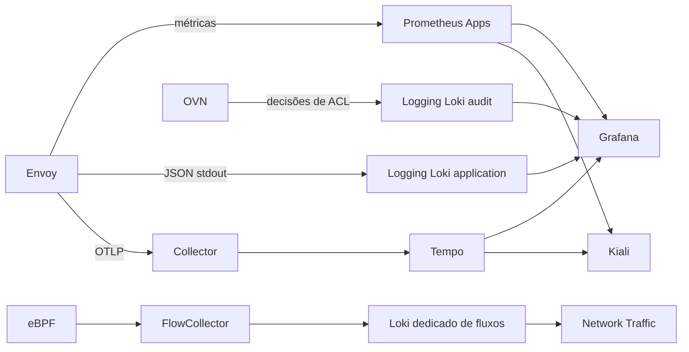

# Arquitetura e integrações

## Responsabilidade por repositório

O Argo CD coordena Applications e AppProjects. Os manifests de cada produto e seus procedimentos pertencem ao repositório do componente. Use o [tutorial de instalação](TUTORIAL-CRC-STACK.md) como sequência de bootstrap e os links abaixo para operação específica.

| Repositório | Responsabilidade | Dependências / consumidores |
|---|---|---|
| [openshift-local-installer](https://github.com/thiagobotelho/openshift-local-installer) | CRC, virtualização e bootstrap | Host preparado; inicia esta plataforma |
| [openshift-cli-installer](https://github.com/thiagobotelho/openshift-cli-installer) | Binários e perfis do terminal | Não autentica nem atribui privilégios no cluster |
| [argocd-gitops](https://github.com/thiagobotelho/argocd-gitops) | Reconciliação, fontes e permissões das Applications | OpenShift GitOps Operator e acesso ao Git |
| [keycloak-gitops](https://github.com/thiagobotelho/keycloak-gitops) | IdP e clients OIDC/SAML | Banco e Secrets; consumidores aplicam sua autorização |
| [keycloak-theme-botelho](https://github.com/thiagobotelho/keycloak-theme-botelho) | Artefato visual do IdP | Versão de servidor compatível |
| [keycloak-post-exporter](https://github.com/thiagobotelho/keycloak-post-exporter) | Medição externa de client_credentials | Keycloak e Prometheus; não mede login interativo |
| [prometheus-gitops](https://github.com/thiagobotelho/prometheus-gitops) | MonitoringStack de aplicações | Namespaces/monitores/regras selecionados por labels |
| [loki-gitops](https://github.com/thiagobotelho/loki-gitops) | Logging, armazenamento e consultas LogQL | S3, coleta e RBAC por tenant |
| [tempo-gitops](https://github.com/thiagobotelho/tempo-gitops) | Backend de traces | Collector envia; Grafana e Kiali consultam o gateway |
| [opentelemetry-gitops](https://github.com/thiagobotelho/opentelemetry-gitops) | Recepção e exportação OTLP | Tempo; descoberta do Service pelo Istiod para tracing do mesh |
| [pyroscope-gitops](https://github.com/thiagobotelho/pyroscope-gitops) | Backend de profiles | Instrumentação no processo emissor; Grafana consulta |
| [grafana-gitops](https://github.com/thiagobotelho/grafana-gitops) | Datasources, dashboards e correlação | Backends disponíveis, CAs e credenciais próprias |
| [zabbix-gitops](https://github.com/thiagobotelho/zabbix-gitops) | Zabbix em OpenShift e bootstrap SAML | Banco, IdP; credencial própria para datasource Grafana |
| [network-observability-gitops](https://github.com/thiagobotelho/network-observability-gitops) | Agentes, FlowCollector e Loki de fluxos | S3 e bootstrap dedicado; separado do Loki de Logging |
| [service-mesh-gitops](https://github.com/thiagobotelho/service-mesh-gitops) | Istio/CNI, revisão e Kiali opcional | Prometheus Apps; perfil completo usa Collector/Tempo/Logging/Grafana |
| [mesh-apps-lab](https://github.com/thiagobotelho/mesh-apps-lab) | Workloads e exercícios manuais | Infraestrutura do mesh; cenários têm procedimentos de transição |
| [metallb-gitops](https://github.com/thiagobotelho/metallb-gitops) | Endereços LoadBalancer e anúncio L2 | Rede/IPAM; opcional para os exercícios internos por ClusterIP |
| [client-ip-api-openshift](https://github.com/thiagobotelho/client-ip-api-openshift) | Inspeção de origem e headers | Router/LB conhecidos; não é mecanismo de autenticação |
| [openshift-aiops-toolkit](https://github.com/thiagobotelho/openshift-aiops-toolkit) | Diagnóstico consultivo | oc autenticado e permissões de leitura; não implanta a stack |

Workstation, dotfiles e laboratórios Vagrant têm ciclo de instalação próprio. Não são Applications da stack. Repositórios de estudo documentam exercícios, sem manter cópias dos manifests dos produtos.

## Perfis opcionais do mesh

Selecione um perfil por vez: todos mantêm a mesma Application `service-mesh`.

| Caminho neste repositório | Fonte selecionada em service-mesh-gitops |
|---|---|
| optional/service-mesh | overlays/desenvolvimento |
| optional/service-mesh-kiali | optional/kiali |
| optional/service-mesh-observability | optional/observability |

Para o perfil completo, estabilize MonitoringStack, Logging, Tempo, Collector e Grafana antes de aplicar:

```bash
oc apply -k optional/service-mesh-observability
oc -n openshift-gitops get application service-mesh
```

Instalação, consultas, interpretação e reversão estão no [guia operacional do mesh](https://github.com/thiagobotelho/service-mesh-gitops/blob/main/docs/OBSERVABILIDADE.md). A biblioteca de LogQL pertence a loki-gitops; Grafana persiste as consultas em painéis. O manual da stack não mantém cópias delas.

## Fluxo de telemetria



## Adaptar e promover

Ajuste domínio, armazenamento, capacidade, imagem, tenant e Secrets no componente proprietário. Labels de descoberta, seleção de monitores e injeção têm propósitos diferentes. Não aplique dois repositórios sobre o mesmo objeto para contornar dependências.

Renderize antes de aplicar; valide admissão, reconciliação e comportamento separadamente. Synced/Healthy não comprova ingestão nem consulta. Registre SHA e evidências em local privado; os guias mantêm comandos e critérios esperados, sem resultados pessoais.

Os perfis CRC usam réplicas e recursos de laboratório. Nomes de overlays aceite/producao não representam homologação de HA, retenção, backup ou capacidade. Planeje esses requisitos antes da promoção.
