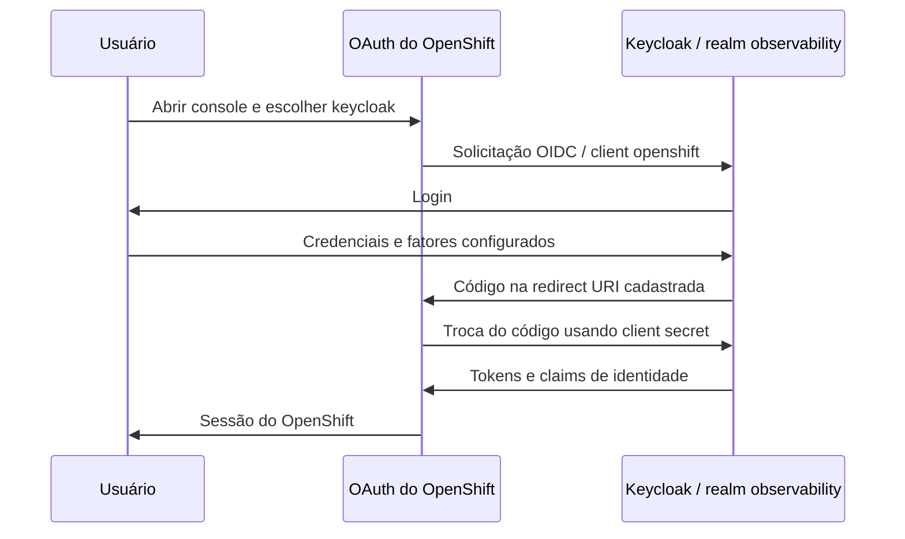

# Autenticação OpenShift com Keycloak no CRC

## Onde está cada configuração

| Componente | Configuração |
|---|---|
| Realm observability e client openshift | [keycloak-gitops/base/keycloak-config-realm.yaml](https://github.com/thiagobotelho/keycloak-gitops/blob/main/base/keycloak-config-realm.yaml) |
| Overlay do Keycloak no laboratório | [keycloak-gitops/overlays/desenvolvimento](https://github.com/thiagobotelho/keycloak-gitops/tree/main/overlays/desenvolvimento) |
| Provedor OpenID do OpenShift e CA pública | [bootstrap/crc-keycloak-provider.yaml](../bootstrap/crc-keycloak-provider.yaml) |
| Objeto OAuth | config.openshift.io/v1, OAuth cluster |
| Credencial do client, fora do Git | Secret openshift-config/keycloak-openshift-client-secret, chave clientSecret |
| CA pública referenciada pelo OAuth | ConfigMap openshift-config/keycloak-issuer-ca, chave ca.crt |



## Client e parâmetros necessários

Sim: a integração precisa do client no Keycloak e do provedor correspondente no OpenShift. Somente instalar Keycloak ou configurar Grafana não configura o login do console.

A configuração base do client usa clientId openshift, protocolo openid-connect, enabled=true, publicClient=false (confidencial), standardFlowEnabled=true, implicitFlowEnabled=false e directAccessGrantsEnabled=false. Cadastre o callback usando o domínio de aplicações do cluster:

```text
https://oauth-openshift.<dominio-de-aplicacoes>/oauth2callback/keycloak
```

O issuer configurado no OAuth é `https://<host-keycloak>/realms/<realm>`. O nome do provedor é keycloak; ele compõe o caminho do callback. Scopes adicionais: email e profile. Os claims são preferred_username, name, email e groups.

O mapper de grupos desse client usa full.path=false: OpenShift não aceita uma barra no nome do objeto Group. Isso é específico do client openshift; não alterar o mapper do Grafana para reproduzir essa decisão. Autenticar não concede cluster-admin: autorização continua sendo feita pelo RBAC do OpenShift.

## Credencial e reprodução em outro CRC

Mantenha o segredo do client fora dos manifests versionados. Obtenha-o por canal administrativo autorizado e transfira-o para o Secret do OpenShift por memória/stdin. O valor precisa ser o mesmo nos dois lados; a existência do Secret, sozinha, não comprova essa igualdade.

Em uma instalação nova, criar/reconciliar o realm/client pelo repositório Keycloak, obter a credencial por canal administrativo autorizado e criar o Secret no namespace openshift-config pela chave clientSecret. Transportar o valor por memória/stdin, sem argumentos de linha de comando, arquivo temporário, terminal, histórico, relatório ou commit. Não inserir um placeholder literal como senha real.

Rotacionar o client secret exige atualizar o Secret OpenShift de forma coordenada. A reconciliação do realm não substitui backup seguro da credencial. Não redefinir senhas de usuários para corrigir um client secret divergente.

## Bootstrap e reconciliação

O arquivo em bootstrap é uma referência de configuração e **não está incluído no overlay normal do Argo CD**. Adapte domínio, issuer, CA e provedores de identidade antes de aplicar.

Antes de reaplicar o bootstrap em outro estado do cluster, revisar os identityProviders existentes e preservar provedores adicionais. Preserve o provedor HTPasswd e outros provedores que devam continuar disponíveis. Aplicar uma lista incompleta pode removê-los. Substitua a CA pública pela cadeia de confiança do issuer e atualize-a em caso de rotação. Não desabilitar a validação TLS.


## Verificar a integração

Confira o provedor no OAuth cluster, a presença do Secret e a cadeia de confiança sem exibir credenciais. Abra o Console, escolha o provedor Keycloak, autentique um usuário e confirme a identidade e as permissões de RBAC. Teste também usuário sem autorização e logout. Após rotacionar o client secret, verifique o login novamente.

## Usuários, grupos e permissões

| Grupo | Membro inicial | Concessão |
| --- | --- | --- |
| openshift-viewers | Nenhum | view nos namespaces da stack |
| openshift-project-admins | observability-admin | admin nos namespaces da stack |
| openshift-cluster-admins | openshift-admin | cluster-admin por entrypoint separado |

Os grupos são declarados no realm de `keycloak-gitops`; o client `openshift`
emite seus nomes sem caminho completo. O provedor OAuth sincroniza a associação
no login. Os usuários de aplicação mantêm seus grupos originais; a nova
associação de `observability-admin` não redefine sua senha.

Aplique [bootstrap/openshift-access](../bootstrap/openshift-access/README.md)
para autorizar acesso somente a grafana, zabbix, tempo, pyroscope, observability
e observability-apps. Admin de projeto permite ler Secrets e gerenciar recursos
locais; não concede administração global. O acesso do Argo CD é independente.

Após novo login no console, confira o User e o Group com uma sessão kubeadmin.
Testes `oc auth can-i --as` validam RBAC por impersonação, sem comprovar o fluxo
OIDC. Mantenha a sessão administrativa até concluir login, papel recebido e
logout. Registre a evidência fora do Git, sem tokens ou senhas.

### Argo CD via OpenShift e Keycloak

Fluxo: Argo CD → Dex → OpenShift OAuth → Keycloak. Use o botão de login
OpenShift e escolha o provedor `keycloak`. O grupo `openshift-cluster-admins`
é mapeado para `role:admin` do Argo em `base/argocd.yaml`; o padrão SSO
continua readonly. Preserve o admin local para recuperação.

A conta `openshift-admin` pertence ao grupo global. Sua senha inicial vem do
Secret `keycloak-dev/keycloak-openshift-users`, chave `OPENSHIFT_ADMIN_PASSWORD`.
Depois da importação, `scripts/initialize-lab-passwords.py --initialize-missing`
do repositório Keycloak inicializa somente senhas ausentes. Nunca versionar ou
publicar os valores. Após rotação, use a senha atual da conta.
