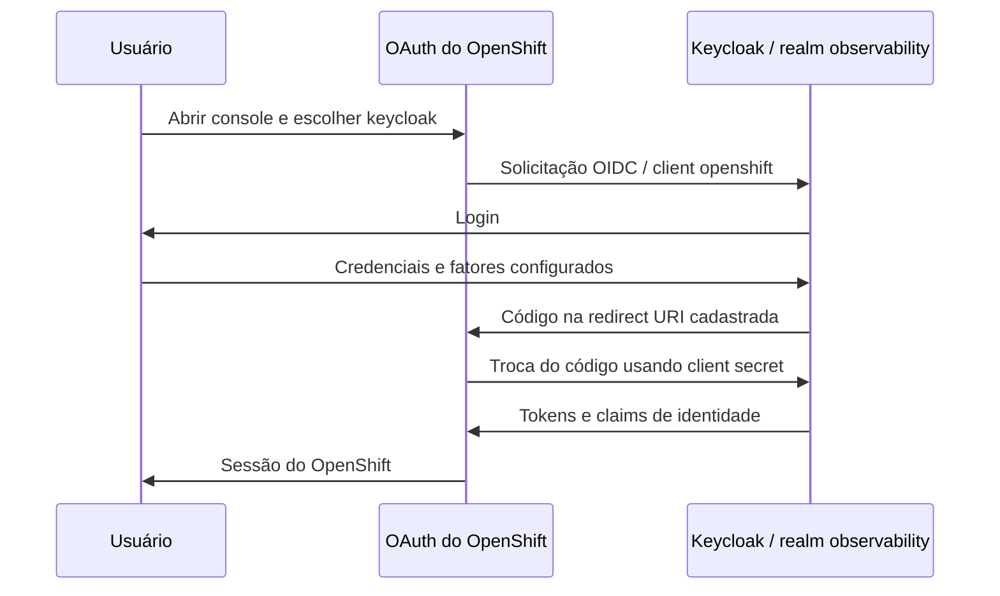

# Autenticação OpenShift com Keycloak no CRC

## Onde está cada configuração

| Componente | Local versionado ou recurso real |
|---|---|
| Realm observability e client openshift | [keycloak-gitops/base/keycloak-config-realm.yaml](https://github.com/thiagobotelho/keycloak-gitops/blob/main/base/keycloak-config-realm.yaml) |
| Overlay do Keycloak no laboratório | [keycloak-gitops/overlays/desenvolvimento](https://github.com/thiagobotelho/keycloak-gitops/tree/main/overlays/desenvolvimento) |
| Provedor OpenID do OpenShift e CA pública | [bootstrap/crc-keycloak-provider.yaml](../bootstrap/crc-keycloak-provider.yaml) |
| Objeto OAuth aplicado | config.openshift.io/v1, OAuth cluster |
| Credencial do client, fora do Git | Secret openshift-config/keycloak-openshift-client-secret, chave clientSecret |
| CA pública referenciada pelo OAuth | ConfigMap openshift-config/keycloak-issuer-ca, chave ca.crt |



## Client e parâmetros necessários

Sim: a integração precisa do client no Keycloak e do provedor correspondente no OpenShift. Somente instalar Keycloak ou configurar Grafana não configura o login do console.

O client versionado usa clientId openshift, protocolo openid-connect, enabled=true, publicClient=false (confidencial), standardFlowEnabled=true, implicitFlowEnabled=false e directAccessGrantsEnabled=false. O callback exato é:

```text
https://oauth-openshift.apps-crc.testing/oauth2callback/keycloak
```

O issuer configurado no OAuth é `https://keycloak-dev.apps-crc.testing/realms/observability`. O nome do provedor é keycloak; ele compõe o caminho do callback. Scopes adicionais: email e profile. Os claims são preferred_username, name, email e groups.

O mapper de grupos desse client usa full.path=false: OpenShift não aceita uma barra no nome do objeto Group. Isso é específico do client openshift; não alterar o mapper do Grafana para reproduzir essa decisão. Autenticar não concede cluster-admin: autorização continua sendo feita pelo RBAC do OpenShift.

## Credencial e reprodução em outro CRC

O segredo do client não está no YAML nem no repositório. No laboratório configurado, ele foi obtido do client Keycloak e transferido para o Secret do OpenShift apenas em memória. O valor precisa ser o mesmo nos dois lados; a existência do Secret, sozinha, não comprova essa igualdade.

Em uma instalação nova, criar/reconciliar o realm/client pelo repositório Keycloak, obter a credencial por canal administrativo autorizado e criar o Secret no namespace openshift-config pela chave clientSecret. Transportar o valor por memória/stdin, sem argumentos de linha de comando, arquivo temporário, terminal, histórico, relatório ou commit. Não inserir um placeholder literal como senha real.

Rotacionar o client secret exige atualizar o Secret OpenShift de forma coordenada. A reconciliação do realm não substitui backup seguro da credencial. Não redefinir senhas de usuários para corrigir um client secret divergente.

## Bootstrap e reconciliação

O arquivo em bootstrap é um snapshot declarativo do CRC e **não está incluído no overlay normal do Argo CD**. O OAuth e o ConfigMap já foram aplicados anteriormente no laboratório; não são reaplicados nesta integração do Mesh.

Antes de reaplicar o bootstrap em outro estado do cluster, revisar os identityProviders existentes e preservar provedores adicionais. O arquivo inclui o provedor developer/HTPasswd do CRC original; aplicá-lo sem revisão pode substituir a lista atual. A CA pública é específica do laboratório: renovar a referência quando a cadeia TLS mudar. Não desabilitar a validação TLS.

## Evidência e limites

Em 27/10/2026, uma consulta somente em leitura confirmou o provedor OpenID keycloak no OAuth cluster com o issuer/clientID/referências acima, e confirmou a existência do Secret apenas por metadados. Nenhum valor de credencial foi exibido ou comparado nesta leitura.

O fluxo de login OpenShift/Argo por Keycloak já havia sido validado por protocolo na etapa anterior do laboratório. Esta integração do Mesh não repete login, MFA ou validação visual em navegador e não modifica autenticação.
